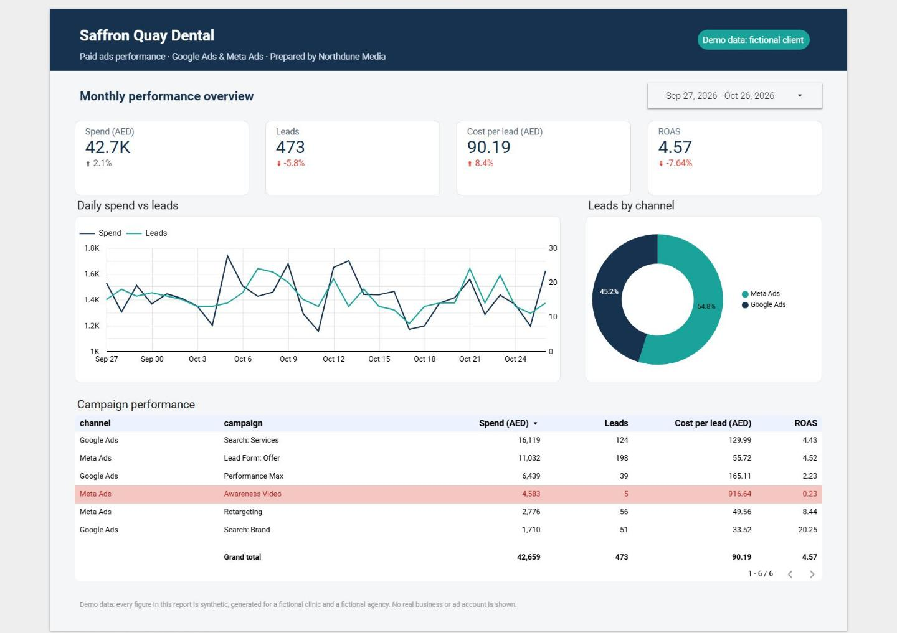
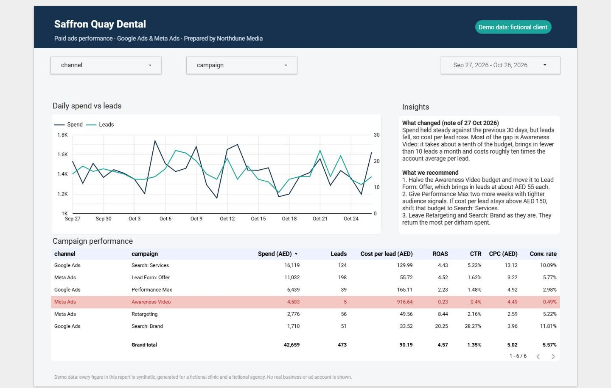

# Paid Ads Performance Report (Looker Studio demo)

A two-page client report for a **fictional** Dubai dental clinic, combining Google Ads and Meta Ads
data in Looker Studio (now called Data Studio). It is a portfolio piece: the clinic, the agency and every
number are synthetic.

**Live report (view only):** https://datastudio.google.com/reporting/a0f55ee5-e167-4353-b5f2-fae8fa36a248

| Monthly performance overview | Campaign drill-down |
|---|---|
|  |  |

## What the report shows

- **Page 1, for the clinic owner:** spend, leads, cost per lead and ROAS for the last 30 days against the
  30 days before, daily spend vs leads, leads by channel, and a campaign table that turns a campaign red
  when it returns less than it costs (ROAS below 1).
- **Page 2, for the account manager:** channel and campaign filters driving a trend chart and a fuller
  table (CTR, CPC, conversion rate), plus a short written note on what changed and what to do next.

## How it is built

1. `make_demo_data.py` (seed 42) writes `ads_daily.csv`: one row per day per campaign, six campaigns
   across the two channels, with columns `date, channel, campaign, spend_aed, impressions, clicks, leads,
   conversions_value_aed`. The data has UAE weekday/weekend patterns (the weekend is Saturday–Sunday),
   a mid-period budget increase and one deliberately weak campaign. The cost-per-click and click-through
   assumptions are commented at the top of the script.
2. The CSV is loaded into a Google Sheet, which is the report's data source.
3. Every ratio is a calculated field written as a sum divided by a sum, so it stays correct under any
   date range or filter:

   | Field | Formula |
   |---|---|
   | CTR | `SUM(clicks) / SUM(impressions)` |
   | CPC | `SUM(spend_aed) / SUM(clicks)` |
   | Cost per lead | `SUM(spend_aed) / SUM(leads)` |
   | Conversion rate | `SUM(leads) / SUM(clicks)` |
   | ROAS | `SUM(conversions_value_aed) / SUM(spend_aed)` |

4. **Why the report stays current.** The file holds 90 days of history plus a year of pre-generated
   days. A report-level filter keeps only rows dated before today (Dubai time), using this field:

   ```
   CASE WHEN date < TODAY("Asia/Dubai") THEN "Past" ELSE "Future" END
   ```

   So each morning one more day appears and "Last 30 days" always has data, with nobody re-running the
   script.

## Reproduce the data

```bash
pip install numpy pandas
python make_demo_data.py --end 2026-10-14
```

That reproduces the committed `ads_daily.csv` exactly (2,730 rows, 2026-07-17 to 2027-10-14) and prints
totals for checking. Without `--end`, the history ends yesterday.

## Demo data note

Everything here is invented for demonstration. The names *Saffron Quay Dental* and *Northdune Media* are
fictional, and no real business, ad account or platform data is used.
